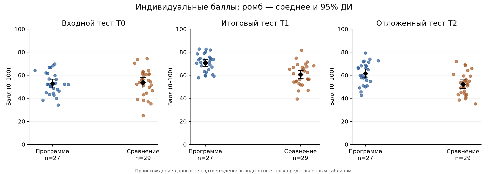
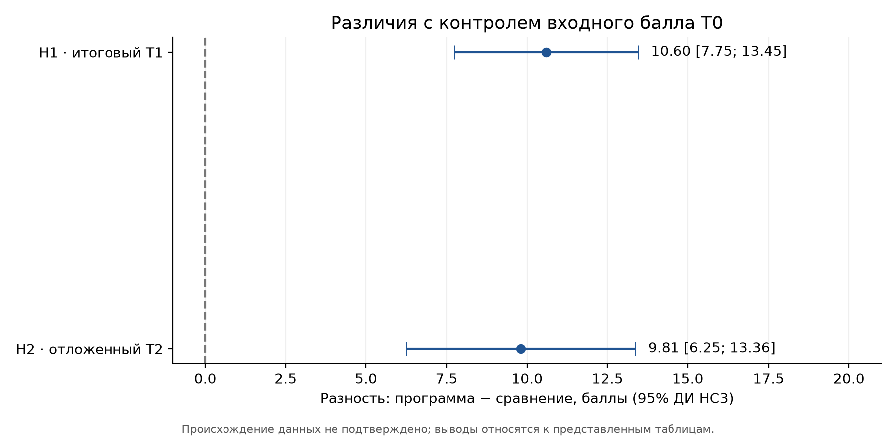
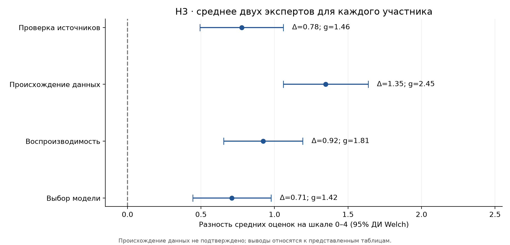
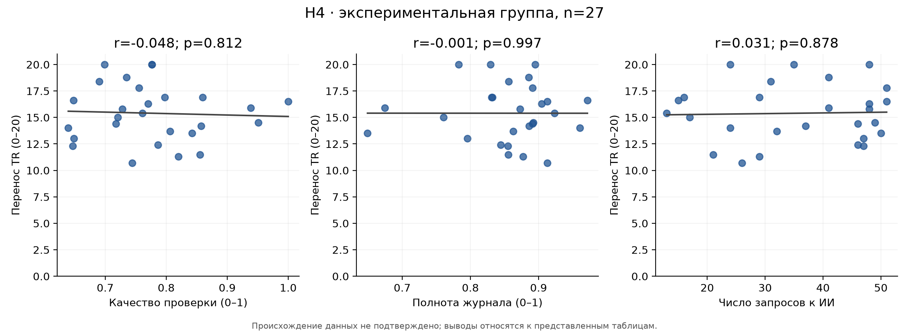
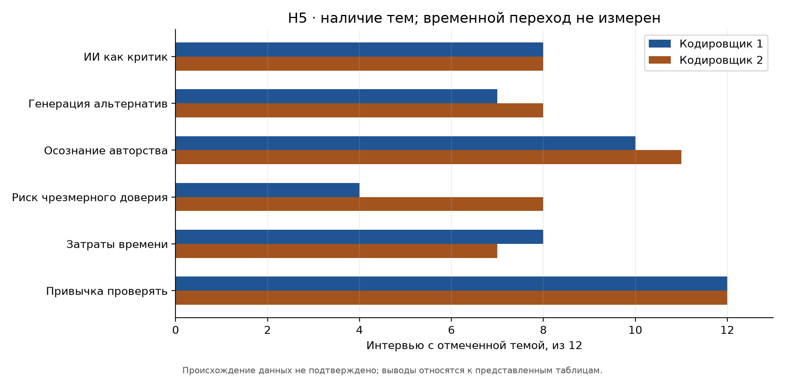
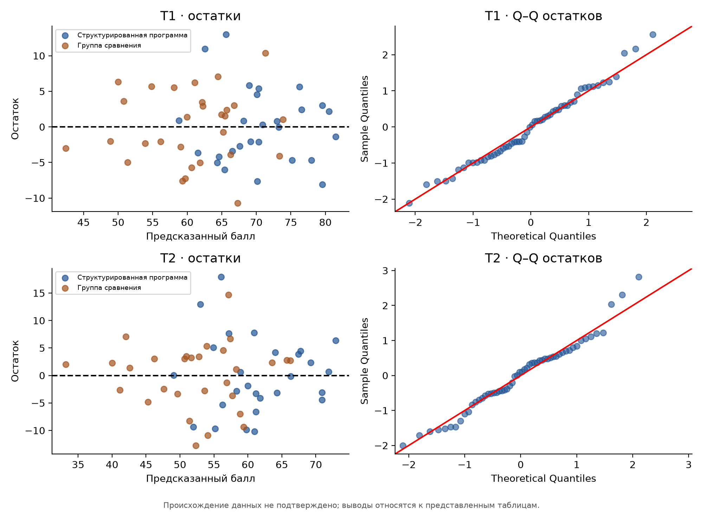

# Проверка H1–H5 по 16 CSV

Анализ выполнен 10 октября 2026 года. Исходный снимок: [a2a5246](https://github.com/PetrNikitin20/GAI_Educ/tree/a2a5246960889eaad21681d432c2dfc13839d2f0). Все 16 исходных CSV сохранены без изменений. Таблицы пересчитаны из строк участников, ответов и экспертных оценок; готовые сводки использованы только для проверки согласованности.

## Главный вывод и происхождение данных

**Таблица численно поддерживает H1, различие T2 в H2 и четыре показателя H3. H4 не поддерживается. Для H5 доступны частоты тем, но переход к иной стратегии использования ИИ установить нельзя. Эти результаты не доказывают реальный эффект программы: первичное происхождение наблюдений не подтверждено.**

Это ограничение следует из структуры файлов и истории набора:

- В [историческом снимке d6a7855](https://github.com/PetrNikitin20/GAI_Educ/blob/d6a7855a96292864a47dc92d8cd83257f9a6da67/csv/Сводка.csv) первая строка `csv/Сводка.csv`: «Воспроизводимая реконструкция чисел статьи». В текущем исходном снимке a2a5246 этот заголовок и одна пустая строка удалены; численные строки и остальные 15 CSV не изменены. Поэтому заголовок цитируется как свидетельство истории набора, а не как строка текущего файла.
- `csv/Проверка_ссылок.csv`: способ — «макет проверки DOI или каталога», примечание — «структурная запись для воспроизведения числителя и знаменателя». Идентификаторы `REF:...` не являются реальными DOI или адресами источников.
- `csv/Ответы_интервью.csv` содержит 72 вопроса для 12 участников, но **не содержит ответов**. В тестах есть коды ответов и баллы, но нет текстов заданий/ответов.
- Нет протокола назначения групп, дат, интервала T1–T2, содержания новой задачи, данных о преподавателях и учебных кластерах. Метки `experimental`/`comparison` интерпретированы в соответствии с формулировкой пользователя; реализацию двух программ файлы не описывают.
- Для 29 участников группы сравнения отсутствуют все четыре процессных показателя ИИ; пропуски не заменялись нулями. Нет исходных артефактов или скриптов независимого запуска участников.

Следовательно, p-значения и доверительные интервалы ниже — условные характеристики предоставленной таблицы при принятых статистических предпосылках. Если наблюдения реконструированы под опубликованные числа, эти p-значения не дают новых независимых эмпирических доказательств. Этот отчёт нельзя представлять как верификацию первичного эксперимента.

| Гипотеза | Результат проверки | Граница вывода |
| --- | --- | --- |
| H1 | Численно поддерживается в представленной таблице | Первичное происхождение и рандомизация не подтверждены |
| H2 | Различие T2 поддерживается; новая задача не верифицирована | Нет текста новой задачи и интервала отложенного теста |
| H3 | Четыре оценки рубрики численно поддерживают гипотезу | Нет исходных артефактов, реальных DOI, данных или исполняемого кода участников |
| H4 | Не поддерживается | n=27; ДИ различий связей включают 0; результаты не доказывают отсутствия эффекта |
| H5 | Темы представлены; переход не может быть установлен | Нет текстов ответов, цитат, временных сравнений и контрольных интервью |

## Данные и единицы анализа

56 участников: 27 в экспериментальной группе и 29 в группе сравнения. Во всех таблицах группы и наблюдения соединены по коду участника. Единица статистического анализа — **участник**, а не отдельный запрос к ИИ, ссылка или оценка эксперта. Оценки двух экспертов сначала усреднены внутри участника и критерия. Шкалы T0/T1/T2 — 0–100, перенос TR — 0–20, ИИ-грамотность — 0–40, экспертные критерии — 0–4. Максимумы тестовых шкал получены из сумм максимальных баллов заданий.

| Показатель | Программа, n=27 | Сравнение, n=29 |
| --- | --- | --- |
| Входной балл T0 (0–100) | 52.76 ± 9.65 | 53.56 ± 11.69 |
| Итоговый балл T1 (0–100) | 70.69 ± 7.72 | 60.60 ± 9.31 |
| Отложенный балл T2 (0–100) | 61.57 ± 9.57 | 52.30 ± 9.81 |
| Перенос TR (0–20) | 15.40 ± 2.69 | 12.30 ± 3.32 |
| ИИ-грамотность (0–40) | 31.79 ± 4.69 | 26.84 ± 4.54 |
| Сумма экспертной рубрики (0–32) | 26.19 ± 1.54 | 19.97 ± 1.49 |

Здесь M ± SD. Пропусков T0/T1/T2/TR или опыта программирования среди включённых 56 участников нет. Из файлов нельзя установить набор до включения и фактическое выбытие участников. Таблицы `01_data_inventory.csv`, `17_missingness.csv`, `18_data_dictionary.csv` описывают структуру и пропуски; словарь фиксирует исходные поля и типы, а не заменяет отсутствующий исследовательский протокол.



## H1: итоговый балл при контроле входного уровня

Основная модель: `T1 = β0 + β1·группа + β2·T0 + ε`, где группа 1 — структурированная программа, 0 — сравнение. Применены стандартные ошибки **HC3** и t-интервалы с остаточными степенями свободы. β1 — скорректированная разность групп. Входной уровень включён независимо от его статистической значимости. Аналогичная модель применена для H2.

## H2: отложенный тест

Основной исход H2 — балл T2 с контролем T0. Балл TR анализируется отдельно как дополнительный исход переноса; он не подменяет T2. Файл называет T2 отложенным тестом, но не позволяет проверить, через сколько времени и на какой новой задаче он выполнен. Поэтому установлено численное сохранение различия T2, а полная формулировка H2 требует протокола задач и дат.

| Исход | Разность групп | 95% ДИ: низ | 95% ДИ: верх | p HC3 | p Holm |
| --- | --- | --- | --- | --- | --- |
| T1, итоговый | 10.598 | 7.750 | 13.446 | 8.11e-10 | 4.05e-09 |
| T2, отложенный | 9.806 | 6.251 | 13.361 | 9.92e-07 | 2.98e-06 |
| TR, перенос (дополнительно) | 3.285 | 2.338 | 4.232 | 5.25e-09 | н.д. |



Шесть основных проверок образуют одну семью: T1, T2 и четыре критерия H3. Для них использована поправка **Holm**. Проверки двусторонние, α=0,05; обычные 95% ДИ не являются одновременными интервалами для всей семьи. TR и ИИ-грамотность — дополнительные исходы. Наличие контроля T0 не устраняет различия в мотивации, преподавателях или других неизмеренных факторах.

В `04_ancova.csv` также приведены модели с опытом программирования и классическими OLS-ошибками. Модель с T0 и опытом воспроизводит старую сводку: ΔT1=9,962, ΔT2=9,925; основная модель выше контролирует только T0 и использует HC3. Различие результатов объясняется набором ковариат и оценкой ошибок. OLS-модель служит проверкой чисел уже существующей сводки. Проверки остатков, взаимодействия группа×T0 и влияния наблюдений сохранены в `05_model_diagnostics.csv`. Незначимый тест взаимодействия не доказывает равенство наклонов. Если группы соответствуют отдельным классам, индивидуальные HC3-ошибки не учитывают кластеризацию; идентификаторов классов в данных нет.

## H3: качество проектных артефактов

Основные показатели — четыре заранее названных в гипотезе критерия. Для каждого участника взято среднее оценок двух экспертов. Сравнение средних выполнено тестом Welch, ДИ разности построен с его степенями свободы. **g Хеджеса** — нескорректированный стандартизованный эффект, рассчитанный через объединённое SD участников с поправкой на малую выборку. Четыре p-значения включены в основную семью Holm вместе с H1/H2. Остальные критерии и сумма рубрики — описательный дополнительный анализ. Проверка Mann–Whitney сохранена как чувствительность к порядковой природе шкалы.

| Критерий | Программа, M | Сравнение, M | Δ | ДИ низ | ДИ верх | g | p Holm |
| --- | --- | --- | --- | --- | --- | --- | --- |
| Проверка источников | 3.259 | 2.483 | 0.777 | 0.493 | 1.060 | 1.456 | 2.98e-06 |
| Происхождение данных | 3.556 | 2.207 | 1.349 | 1.060 | 1.637 | 2.449 | 6.41e-12 |
| Воспроизводимость | 3.389 | 2.466 | 0.923 | 0.655 | 1.192 | 1.812 | 2.52e-08 |
| Выбор модели | 3.296 | 2.586 | 0.710 | 0.444 | 0.976 | 1.418 | 2.98e-06 |



Все четыре разности положительны. Это свидетельство различий **зарегистрированных оценок**, но не независимая проверка источников, происхождения данных или реального запуска проектов: исходных проектов и доказательств этих действий в репозитории нет.

Дополнительные операционные показатели рассчитаны на уровне участников:

| Показатель | Программа | Сравнение | Δ | ДИ низ | ДИ верх | p Holm, доп. |
| --- | --- | --- | --- | --- | --- | --- |
| Доля проверенных ссылок | 0.964 | 0.782 | 0.182 | 0.128 | 0.241 | 1.86e-07 |
| Неподтверждённые утверждения на 1000 слов | 0.485 | 1.619 | -1.134 | -1.426 | -0.837 | 2.00e-07 |
| Успешное воспроизведение | 0.815 | 0.448 | 0.367 | 0.120 | 0.610 | 0.006 |
| Обоснованный выбор модели | 0.926 | 0.552 | 0.374 | 0.165 | 0.584 | 0.004 |

Доли в таблице выражены от 0 до 1; разность 0,10 означает 10 процентных пунктов. Проверенные ссылки: 298/310 и 290/368 в сумме по группам; значения таблицы — средние индивидуальных долей, поэтому могут отличаться от этих агрегированных отношений. Воспроизведение: 22/27 и 13/29; обоснование модели: 25/27 и 16/29. Для бинарных признаков использован точный тест Fisher, для доли ссылок и частоты утверждений — Mann–Whitney. Их p-значения скорректированы Holm в отдельной дополнительной семье из четырёх проверок. ДИ разностей — стратифицированный по группе bootstrap участников, 20,000 повторов. ДИ относится к разности средних, а Mann–Whitney проверяет распределения, поэтому они отвечают на разные статистические вопросы.

## H4: связь процесса использования ИИ с переносом

Анализ ограничен **27 участниками экспериментальной группы**. Полнота, качество проверки и число запросов не измерены в группе сравнения. Основные процессные показатели взяты из `Участники.csv`; это агрегаты без опубликованной формулы их получения.

| Показатель | r Pearson | ДИ низ | ДИ верх | p Pearson | ρ Spearman | p перестановки |
| --- | --- | --- | --- | --- | --- | --- |
| Качество проверки | -0.048 | -0.348 | 0.229 | 0.812 | -0.053 | 0.794 |
| Полнота журнала | -7.17e-04 | -0.304 | 0.275 | 0.997 | -0.008 | 0.966 |
| Число запросов | 0.031 | -0.301 | 0.348 | 0.878 | 0.036 | 0.859 |

95% ДИ корреляций — bootstrap с повторной выборкой целых участников; p Spearman — перестановочный тест пар, 20,000 повторов, с сохранением связок рангов. Это разведочные проверки. Все три линейные связи близки к нулю; отсутствие значимости не устанавливает отсутствия связи в популяции.



Для сравнения «сильнее, чем число запросов» недостаточно сравнить два отдельных p-значения. Прямо оценены зависимые разности `r(качество, TR) − r(запросы, TR)` и `r(полнота, TR) − r(запросы, TR)`, а также разности абсолютных корреляций, с совместным bootstrap участников. Кроме того, рассчитана стандартизованная множественная регрессия `TR ~ качество + полнота + запросы + T0 + опыт` с HC3. Стандартизация всех пяти предикторов и исхода выполнена внутри этой группы, SD с ddof=1. Две разности условных β проверены непосредственно Wald t-тестами и скорректированы Holm. Подписанные β оценивают направление условной связи, а разности абсолютных r — силу связи без направления.

| Предиктор | Стандартизованный β | ДИ низ | ДИ верх | p HC3 |
| --- | --- | --- | --- | --- |
| Качество проверки | -0.151 | -0.409 | 0.106 | 0.235 |
| Полнота журнала | -0.052 | -0.386 | 0.282 | 0.748 |
| Число запросов | -0.009 | -0.218 | 0.201 | 0.934 |
| Входной балл T0 | 0.870 | 0.616 | 1.124 | 5.12e-07 |
| Опыт программирования | -0.004 | -0.314 | 0.307 | 0.981 |

| Сравнение | Оценка | Разность | ДИ низ | ДИ верх | p Holm |
| --- | --- | --- | --- | --- | --- |
| Качество − запросы | β HC3 | -0.143 | -0.483 | 0.198 | 0.787 |
| Качество − запросы | r, парный bootstrap | -0.079 | -0.534 | 0.389 | н.д. |
| Качество − запросы | \|r\|, парный bootstrap | 0.017 | -0.289 | 0.267 | н.д. |
| Полнота − запросы | β HC3 | -0.044 | -0.441 | 0.354 | 0.821 |
| Полнота − запросы | r, парный bootstrap | -0.032 | -0.492 | 0.441 | н.д. |
| Полнота − запросы | \|r\|, парный bootstrap | -0.030 | -0.299 | 0.251 | н.д. |

**H4 не поддерживается:** интервалы прямых разностей включают ноль. Детали β, VIF и R² сохранены в `09_h4_regression.csv`. n=27 при пяти предикторах даёт широкую неопределённость; процессные показатели наблюдательные и могут зависеть от способностей и сложности задания. Они не устанавливают причинный механизм программы.

Средние оценки из `Журнал_ИИ.csv` немного расходятся с агрегатами участника. Формула агрегирования отсутствует; основной анализ не исправлял исходные значения. Чувствительность к средним по журналу: r качества=-0.053, r полноты=-0.000, r числа строк=0.031. Вывод H4 остаётся тем же. Сопоставление по каждому участнику — `11_h4_log_audit.csv`. Всего 962 строки журнала; они не считаются 962 независимыми участниками.

## H5: темы интервью и пределы качественного вывода

Доступны 12 интервью **только экспериментальной группы**, каждое с шестью бинарными темами и двумя кодировщиками. Нет текстов ответов, начальных интервью или контрольной группы. Поэтому можно описать наличие тем, но нельзя реконструировать цитаты или доказать **переход** к использованию ИИ как критика/источника альтернатив. «Затраты времени» — метка темы, а не измерение затраченных минут. Код ошибки в журнале не даёт времени или контекста изменения стратегии.

| Тема | Кодировщик 1 /12 | Кодировщик 2 /12 | Оба отметили /12 | Разногласий | κ |
| --- | --- | --- | --- | --- | --- |
| ИИ как критик | 8 | 8 | 8 | 0 | 1.000 |
| Генерация альтернатив | 7 | 8 | 7 | 1 | 0.824 |
| Осознание авторства | 10 | 11 | 10 | 1 | 0.625 |
| Риск чрезмерного доверия | 4 | 8 | 4 | 4 | 0.400 |
| Затраты времени | 8 | 7 | 7 | 1 | 0.824 |
| Привычка проверять | 12 | 12 | 12 | 0 | н.д. |

Сводка `Темы_интервью.csv` воспроизводит **кодировщика 1**, а не согласованное итоговое решение. Разногласия нельзя автоматически разрешать в пользу подтверждения гипотезы. Особенно различается риск чрезмерного доверия: 4/12 у первого и 8/12 у второго кодировщика; окончательное число требует согласования с транскриптами.

Общее согласие — 90.3%, объединённая κ по 72 меткам — 0.763. Объединение разных тем может скрывать тематические разногласия; эти метки также зависимы внутри интервью. У темы «Привычка проверять» оба кодировщика отметили все интервью, поэтому κ не определена из-за отсутствия вариации, а не равна единице. Wilson-интервалы частот приведены в CSV как описательные ориентиры; неизвестный способ отбора 12 интервью не позволяет переносить их на всех участников.



**Итог H5:** коды согласуются с наличием критики, альтернатив, затрат времени и риска доверия. Качественное свидетельство изменения стратегии требует транскриптов, фрагментов с датами/идентификаторами, правила отбора интервью и описанного процесса согласования кодирования. В этом анализе цитаты не выдумывались.

## Проверка данных и моделей

Суммы баллов по 2 352 строкам заданий совпадают с 280 итоговыми значениями пяти инструментов. 896 экспертных оценок и 678 записей ссылок согласуются с таблицей участников; это подтверждает внутреннюю согласованность, но не первичную достоверность. Существующие 62 строки `Проверки.csv` не использованы как внешнее подтверждение; исходные агрегаты пересчитаны самостоятельно.

Найдены следующие расхождения при проверке простого среднего журнальных оценок (они могут объясняться другой, неописанной агрегацией):

| check | result | detail |
| --- | --- | --- |
| Полнота равна среднему по журналу | FAIL | Максимальное расхождение 0.011763; агрегирующая методика не описана |
| Качество равно среднему по журналу | FAIL | Максимальное расхождение 0.022925; агрегирующая методика не описана |

Диагностика H1/H2:



## Воспроизведение и файлы

```bash
python -m venv .venv
# Windows PowerShell:
.venv\Scripts\Activate.ps1
# Linux/macOS: source .venv/bin/activate
python -m pip install -r analysis/requirements.txt
python analysis/run_analysis.py --root .
python analysis/validate_results.py --root .
```

Использован Python 3.12, seed=20261010, 20,000 bootstrap/перестановочных повторов. Скрипт пересоздаёт только файлы в `analysis/`, проверяет ключи и шкалы, не редактирует `csv/` или старые `figures/`. Пакеты и хеши SHA-256 исходников записаны в `manifest.json`, проверенный снимок закреплён в `source_sha256.json`. При расчёте хешей CRLF нормализуется в LF, BOM сохраняется; это обеспечивает одинаковую проверку Git-выгрузок в Windows и Linux, не меняя исходные файлы. `results.json` содержит ключевые численные результаты. `tables/` содержит 18 CSV с UTF-8 BOM; `figures/` — шесть рисунков в PNG и SVG. Все оценки рассчитаны в Python, CSV — сохранённые результаты. Повторный запуск воспроизводит этот снимок; если исходные данные заменены, код останавливается до пересмотра плана анализа и обновления хешей. Текст отчёта и выводы написаны для данного снимка. Проверки и методы выбраны после ознакомления с доступными файлами, регистрации плана до эксперимента нет.

## Источники методов

- [statsmodels: HC3 и робастная ковариация](https://www.statsmodels.org/stable/generated/statsmodels.regression.linear_model.OLSResults.get_robustcov_results.html) — выбор ковариационной матрицы для линейной модели.
- [statsmodels: поправки множественных проверок](https://www.statsmodels.org/stable/generated/statsmodels.stats.multitest.multipletests.html) — Holm.
- [SciPy: bootstrap и парное ресэмплирование](https://docs.scipy.org/doc/scipy/reference/generated/scipy.stats.bootstrap.html) — принцип сохранения пар; здесь ресэмплирование реализовано явно для совместных разностей.
- [SciPy: Spearman](https://docs.scipy.org/doc/scipy/reference/generated/scipy.stats.spearmanr.html) — перестановочная проверка для небольшой выборки.

Для полноценной проверки заявленного реального эксперимента нужны первичные обезличенные наблюдения с документированным происхождением, протокол распределения групп и задач, исходные артефакты и транскрипты. Наличие этих материалов изменит доказательную силу анализа; оно не может быть заменено точным воспроизведением сводных чисел.
